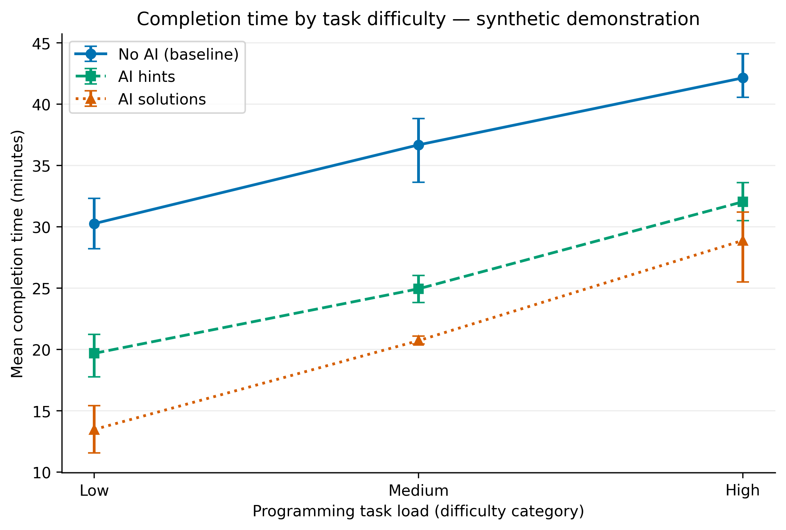
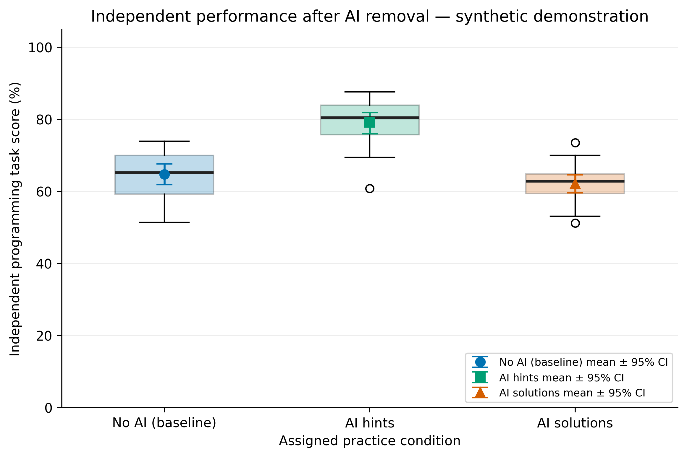

# The Impact of Generative AI Assistance on Programming Learning Effectiveness Among Undergraduate Students

**Authors:** Yerkindik Ailen and Aitkali Dariga  
**Research Type:** Quantitative Experimental Study  
**Course:** Research Methods, 2026  
**Repository:** https://github.com/aitkalidariga/AI-Programming-Research-Team

## 1. Project Overview

This research examines how generative AI assistance affects programming learning among undergraduate students.

The planned experiment compares three groups:

- **Group A (No AI):** Students complete programming tasks without AI assistance.
- **Group B (AI Hints):** Students use AI-generated hints and explanations.
- **Group C (AI Solutions):** Students use direct AI-generated solutions.

The study focuses on task performance, completion time, understanding of programming concepts, and independent problem-solving skills.

## 2. Research Questions

**RQ1:** How does access to generative AI during programming exercises affect students' task performance and completion time compared with learning without AI?

**RQ2:** How does the use of generative AI during programming practice affect students' understanding and retention when AI assistance is later removed?

**RQ3:** Which type of AI support, explanations and hints or direct solution generation, leads to better independent programming performance?

## 3. Research Methodology

**Research Approach:** Quantitative Research

**Research Design:** Planned comparative experiment with three student groups.

### Independent Variables

- Access to generative AI
- Type of AI assistance: No AI, AI Hints, AI Solutions

### Dependent Variables

- Programming task score (%)
- Task completion time (minutes)
- Concept test score (%)
- Number of programming errors
- Independent programming performance without AI

### Controlled Variables

- Programming language
- Task difficulty
- Time limits
- Learning materials
- Evaluation criteria

Previous programming experience will also be considered during analysis.

### Planned Experiment

1. **Initial Assessment:** Evaluate students' programming knowledge before the experiment.
2. **Programming Practice:** Students complete programming tasks under their assigned AI assistance conditions.
3. **Independent Assessment:** Students complete new programming tasks without AI assistance.

The participant count and statistical analysis methods will be determined before collecting real data.

## 4. Research Hypotheses

### RQ1: AI Assistance and Programming Performance

**H0₁:** There is no statistically significant difference in programming task performance and completion time between students using AI assistance and students working without AI.

**H1₁:** Access to generative AI assistance improves programming task performance and reduces completion time compared with working without AI.

### RQ2: AI Assistance and Independent Learning

**H0₂:** Generative AI assistance during practice does not significantly affect students' later independent programming performance.

**H1₂:** Generative AI assistance during practice significantly affects students' later independent programming performance.

### RQ3: Hints Versus Direct Solutions

**H0₃:** There is no statistically significant difference in independent programming performance between students receiving AI-generated hints and students receiving direct AI-generated solutions.

**H1₃:** Students receiving AI-generated hints and explanations achieve higher independent programming performance than students receiving direct AI-generated solutions.

## 5. Evaluation Metrics

| Metric | Description | Unit |
|---|---|---|
| Task Score | Percentage of passed programming test cases | % |
| Completion Time | Time required to complete a task | Minutes |
| Concept Test Score | Percentage of correct answers | % |
| Programming Errors | Number of recorded programming errors | Count |
| Independent Task Score | Task score measured without AI assistance | % |
| Valid Results Rate | Percentage of valid dataset records | % |

**Primary Research Metric:** Independent Programming Task Score (%).

**Secondary Metrics:** Completion time, concept test score, and programming errors.

**Guardrail Metric:** Valid Results Rate (%).

**Baseline:** Students working without AI assistance.

The current benchmark calculates task scores, completion times, concept scores, and programming errors. Independent task performance and valid results rate are planned for the full experiment.

## 6. Repository Structure

```text
AI-Programming-Research-Team/
├── .github/
│   └── workflows/
│       └── main.yml
├── configs/
│   ├── config.json
│   └── config.yaml
├── data/
│   └── sample/
│       └── sample_results.csv
├── src/
│   └── benchmark.py
├── .gitignore
├── Dockerfile
├── LICENSE
├── README.md
└── requirements.txt
```

The final Methodology Passport Card will be added to the `docs/` directory.

## 7. System Requirements

- Docker Desktop
- Windows, Linux, or macOS
- Internet connection for the initial Docker image build

The Docker environment uses Python 3.11.

## 8. Quickstart Guide

Open a terminal in the downloaded repository folder.

### Step 1: Build the Docker Image

```bash
docker build -t ai-programming-research .
```

### Step 2: Run the Benchmark

```bash
docker run --rm ai-programming-research
```

The benchmark reads the sample dataset and calculates average performance metrics for each group.

Dependencies from `requirements.txt` are installed automatically during the Docker image build.

## 9. Sample Benchmark Results

A synthetic dataset containing nine student records was created to test the benchmark.

Each group contains three sample records.

| Group | Average Task Score | Average Completion Time | Average Concept Score |
|---|---|---|---|
| No AI | 70.00% | 35.67 min | 70.00% |
| AI Hints | 86.67% | 25.67 min | 86.67% |
| AI Solutions | 76.67% | 20.33 min | 66.67% |

The benchmark also calculates average programming errors.

In this synthetic example, the AI Hints group has the highest average task and concept scores. The AI Solutions group has the shortest completion time.

**Important:** These results are based on synthetic data, not real students. They are used only to test the benchmark and cannot confirm the research hypotheses.

## 10. Reproducibility and Testing

The repository includes:

- Python benchmark script
- Synthetic CSV dataset
- Configuration files
- Dockerfile
- GitHub Actions workflow

The benchmark uses `configs/config.json` to locate its dataset. The `config.yaml` file contains additional planned settings.

### Docker Testing

The Docker image was successfully built and the benchmark was executed locally.

The output confirmed:

```text
AI Programming Research Benchmark
Data type: synthetic

Group: ai_hints
Number of students: 3
Average task score: 86.67%

Group: ai_solutions
Number of students: 3
Average task score: 76.67%

Group: no_ai
Number of students: 3
Average task score: 70.00%

Benchmark completed successfully.
Note: Synthetic data, not real research results.
```

### GitHub Actions

The repository includes a workflow named **Docker Benchmark Check**.

It automatically builds the Docker image and runs the benchmark when changes are pushed to the repository.

Successful workflow runs are shown with green check marks in the GitHub **Actions** tab.

These checks verify that the benchmark can run successfully.

## 11. Project Status

**Task 2: Methodology and Reproducible Benchmark Pipeline**

Completed:

- Research questions and hypotheses
- Research variables and evaluation metrics
- Python benchmark script
- Synthetic sample dataset
- Docker environment
- Successful local benchmark execution
- GitHub Actions testing

The next research stage will involve collecting real student data, measuring independent programming performance, and conducting statistical analysis.

## 12. Citation and License

Yerkindik, A., & Aitkali, D. (2026). *The Impact of Generative AI Assistance on Programming Learning Effectiveness Among Undergraduate Students*. Research Methods Course Project.

**License:** MIT License. See `LICENSE`.

---

# TASK 3 — Research Results, Data Analysis, and Scientific Visualization

> **IMPORTANT: SYNTHETIC DATA ONLY.** Task 3 is currently a verified technical demonstration. It does not report real student observations, measured learning improvements, hypothesis-test results, or causal findings. Add this section to the existing Task 2 README; do not delete the Task 2 content.

**Research topic:** The Impact of Generative AI Assistance on Programming Learning Effectiveness Among Undergraduate Students  
**Original authors:** Yerkindik Ailen and Aitkali Dariga  
**Baseline:** No AI. Other practice groups: AI Hints and AI Solutions.

## Results & Discussion (Synthetic Demonstration)

The demonstration extends Task 2 with explicit warm-up and evaluation records, statistics for practice performance and independent programming task performance, and plot exports. The source data are fabricated and not the nine-row Task 2 sample dataset.

| Group | Analyzed evaluation records | Independent task score, mean ± SD (%) | Mean completion time (min) | Execution error rate (%) |
|---|---:|---:|---:|---:|
| No AI (baseline) | 18 | 64.75 ± 6.59 | 36.37 | 0.00 |
| AI Hints | 18 | 79.16 ± 6.66 | 25.57 | 0.00 |
| AI Solutions | 17 | 62.13 ± 5.40 | 20.57 | 5.56 |

*Numbers above are illustrative; authoritative exact figures can be regenerated with `python -m src.process_data` and are saved in `data/processed/metrics_summary.csv`. In this example six warm-up runs are excluded; 54 evaluation runs remain, with 53 valid successful runs used in the group performance summary. We do not interpret synthetic differences as study findings.*

### Scientific Figures





Vector versions: [Figure 1 PDF](reports/figures/fig1_latency_vs_load.pdf) · [Figure 2 PDF](reports/figures/fig2_distribution_boxplot.pdf).

### Domain Model

[C4 component model with collection points and definitions](docs/domain_model.md).

### Reproduction

Install dependencies (`pip install -r requirements-task3.txt`), then from the repo root:

```bash
python -m src.process_data --input data/raw/test_run.jsonl --output data/processed/metrics_summary.csv
python -m jupyter nbconvert --to notebook --execute --inplace notebooks/01_data_analysis.ipynb
```

Or open `notebooks/01_data_analysis.ipynb` in Jupyter and run **Kernel → Restart & Run All**. From the project root or `notebooks/` both work. The notebook calls processing and figure functions from `src/`; it has its output cells saved in the committed notebook. Random seeds are fixed for the bootstrap.

### Statistical Definitions

- Independent Task Score (%) = passed independent-task test cases ÷ total test cases × 100.
- Completion Time (min): wall-clock task completion time from synthetic evaluation records.
- Execution Error Rate (%) = failed evaluation runs ÷ total evaluation runs × 100.
- Valid Results Rate (%) = valid evaluation records ÷ total evaluation records × 100.
- p95 and p99: empirical percentiles per group.
- 95% CI: fixed-seed percentile bootstrap (3000 resamples) of the group mean.

### Research Limitations and Next Steps

The generated sample is *not* a replacement for real Weeks 7–8 collection logs. To convert the demonstration into an actual study, collect real participant data with appropriate consent and privacy safeguards; use separate real-data validation, participant-level grouping, preregistered analysis and independent programming assessments. The demo processing script intentionally rejects any data type other than `synthetic` to prevent accidental representation as actual results.

## Interpretation of Statistical Metrics

The Task 3 analysis extends the original benchmark by introducing descriptive statistics and uncertainty estimation for the three experimental conditions: No AI, AI Hints, and AI Solutions.

**Mean and Standard Deviation:** The mean summarizes average performance, while standard deviation describes variation between observations.

**Median and Percentiles:** The median represents the central observation. The 95th and 99th percentiles help identify unusually high values, particularly for task completion time.

**95% Confidence Intervals:** Bootstrap confidence intervals are estimated using 3,000 resamples and fixed random seeds to ensure reproducibility. They illustrate uncertainty in the estimated group means.

**Guardrail Metrics:** Execution error rate and valid results rate are monitored to assess the reliability and quality of the evaluation data.

### Interpretation and Limitations

The current analysis uses synthetic records for demonstrating the research pipeline. The numerical differences between groups must not be interpreted as evidence of actual learning improvements.

Future research will require real participant observations, independent programming assessments, and appropriate statistical hypothesis testing.
