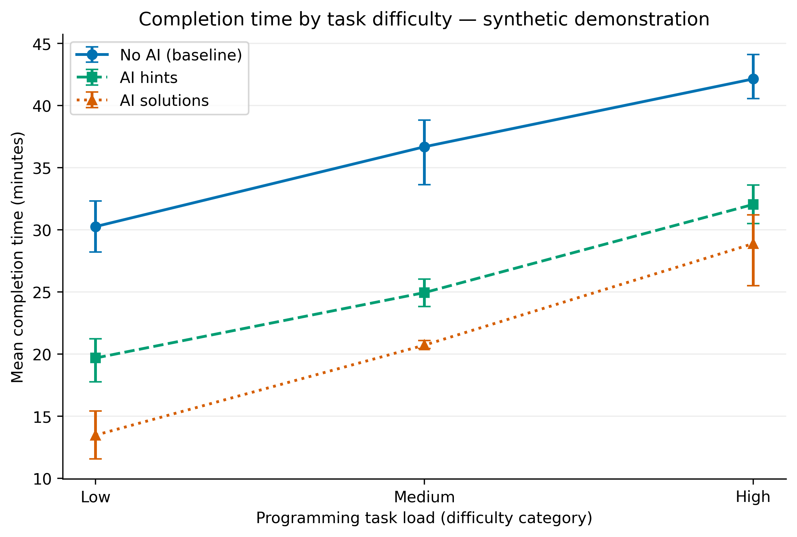
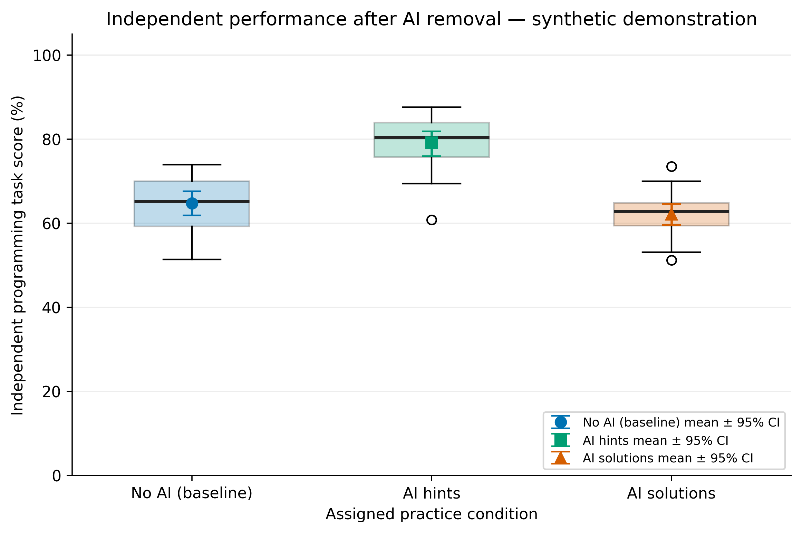

# TASK 3 — Research Results, Data Analysis, and Scientific Visualization

> **IMPORTANT: SYNTHETIC DATA ONLY.** Task 3 is currently a verified technical demonstration. It does not report real student observations, measured learning improvements, hypothesis-test results, or causal findings. Add this section to the existing Task 2 README; do not delete the Task 2 content.

**Research topic:** The Impact of Generative AI Assistance on Programming Learning Effectiveness Among Undergraduate Students  
**Original authors:** Yerkindik Ailen and Aitkali Dariga  
**Baseline:** No AI. Other practice groups: AI Hints and AI Solutions.

## Results & Discussion (Synthetic Demonstration)

The demonstration extends Task 2 with explicit warm-up and evaluation records, statistics for practice performance and independent programming task performance, and plot exports. The source data are fabricated and not the nine-row Task 2 sample dataset.

| Group | Analyzed evaluation records | Independent task score, mean ± SD (%) | Mean completion time (min) | Execution error rate (%) |
|---|---:|---:|---:|---:|
| No AI (baseline) | 18 | 64.75 ± 6.59 | 36.37 | 0.00 |
| AI Hints | 18 | 79.16 ± 6.66 | 25.57 | 0.00 |
| AI Solutions | 17 | 62.13 ± 5.40 | 20.57 | 5.56 |

*Numbers above are illustrative; authoritative exact figures can be regenerated with `python -m src.process_data` and are saved in `data/processed/metrics_summary.csv`. In this example six warm-up runs are excluded; 54 evaluation runs remain, with 53 valid successful runs used in the group performance summary. We do not interpret synthetic differences as study findings.*

### Scientific Figures





Vector versions: [Figure 1 PDF](reports/figures/fig1_latency_vs_load.pdf) · [Figure 2 PDF](reports/figures/fig2_distribution_boxplot.pdf).

### Domain Model

[C4 component model with collection points and definitions](docs/domain_model.md).

### Reproduction

Install dependencies (`pip install -r requirements-task3.txt`), then from the repo root:

```bash
python -m src.process_data --input data/raw/test_run.jsonl --output data/processed/metrics_summary.csv
python -m jupyter nbconvert --to notebook --execute --inplace notebooks/01_data_analysis.ipynb
```

Or open `notebooks/01_data_analysis.ipynb` in Jupyter and run **Kernel → Restart & Run All**. From the project root or `notebooks/` both work. The notebook calls processing and figure functions from `src/`; it has its output cells saved in the committed notebook. Random seeds are fixed for the bootstrap.

### Statistical Definitions

- Independent Task Score (%) = passed independent-task test cases ÷ total test cases × 100.
- Completion Time (min): wall-clock task completion time from synthetic evaluation records.
- Execution Error Rate (%) = failed evaluation runs ÷ total evaluation runs × 100.
- Valid Results Rate (%) = valid evaluation records ÷ total evaluation records × 100.
- p95 and p99: empirical percentiles per group.
- 95% CI: fixed-seed percentile bootstrap (3000 resamples) of the group mean.

### Research Limitations and Next Steps

The generated sample is *not* a replacement for real Weeks 7–8 collection logs. To convert the demonstration into an actual study, collect real participant data with appropriate consent and privacy safeguards; use separate real-data validation, participant-level grouping, preregistered analysis and independent programming assessments. The demo processing script intentionally rejects any data type other than `synthetic` to prevent accidental representation as actual results.
