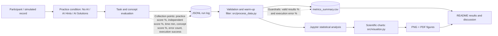

# Task 3 Domain Model — C4 Component View (Software Engineering)

**Study:** The Impact of Generative AI Assistance on Programming Learning Effectiveness Among Undergraduate Students.  
**Data status:** Bundled observations are entirely **synthetic**, for pipeline demonstration. Not real research results.

## Components and measurement points

| Component | Responsibility | Collected metrics |
|---|---|---|
| Task evaluation | Record scored programming attempts | Practice score (%), independent score (%), concept score (%), completion time (min), programming errors (count) |
| JSONL event log | Store records and run phase | `group`, `task_load`, `phase`, `execution_success`, `data_type` |
| Processor | Schema validation, exclusion of warm-up events, descriptive statistics | Valid results rate (%), execution error rate (%), mean, SD, median, p95, p99, bootstrap 95% CI |
| Visualizer | Export reproducible charts | Group confidence intervals and distribution plots |

## Measurement definitions

- **Primary research metric:** independent task score = (passed independent-task test cases / all independent-task test cases) × 100 (%), collected *without AI* after practice.
- **Baseline:** participants assigned to the No AI practice condition.
- **Guardrail:** execution error rate = failed evaluation runs / all evaluation runs × 100 (%). Invalid records are counted separately in valid results rate.
- **Warm-up handling:** each run explicitly has `phase: warmup` or `phase: evaluation`; warm-up runs are excluded **only** from performance estimates.
- **Uncertainty:** percentile bootstrap 95% confidence interval of each group mean, using 3000 resamples and fixed pseudorandom seed. Small synthetic samples cannot establish inferential scientific conclusions.

## Causal validity and study limitations

The current package does **not** measure real student performance. No hypothesis tests, causal findings, or claims about retained knowledge are justified. A real study must document participant recruitment, assignment mechanism, informed consent, tasks and scoring, participant-level clustering, independent post-practice test and later retention follow-up before interpreting these metrics.
