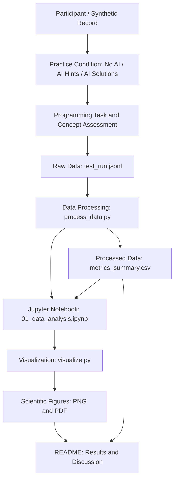

# Task 3 Domain Model — C4 Component View

**Research:** The Impact of Generative AI Assistance on Programming Learning Effectiveness Among Undergraduate Students

**Authors:** Yerkindik Ailen and Aitkali Dariga

**Research track:** Software Engineering

**Data status:** All current observations are synthetic and are used for pipeline demonstration only.

## 1. C4 Component Diagram

The following diagram describes the research data processing pipeline and identifies the main metric collection points.

## 2. Components and Measurement Points

| Component | Responsibility | Collected Metrics |
|---|---|---|
| Practice Condition | Assigns No AI, AI Hints or AI Solutions | Group assignment |
| Programming Assessment | Evaluates programming performance | Practice score, independent score, completion time |
| Concept Assessment | Evaluates conceptual understanding | Concept score |
| Raw Data Logger | Stores experimental records in JSONL | Scores, execution status, errors |
| Data Processor | Validates records and removes warm-up runs | Valid results rate, execution error rate |
| Statistical Analysis | Calculates descriptive statistics | Mean, SD, median, p95, p99, 95% CI |
| Visualization Module | Generates scientific figures | Scores, completion time, confidence intervals |
| README | Documents results and research limitations | Summary tables and figures |

## 3. Data Processing Workflow

1. Load raw JSONL records from `data/raw/test_run.jsonl`.
2. Validate group names, phases and metric values.
3. Exclude warm-up records from evaluation.
4. Calculate execution error rates for evaluation records.
5. Calculate statistics for valid successful evaluation runs.
6. Export aggregated results to `data/processed/metrics_summary.csv`.
7. Generate scientific plots using `src/visualize.py`.
8. Display results and figures in `README.md`.

## 4. Statistical Metrics

### Primary Metric

Independent Programming Task Score (%):

\[
S = \frac{P}{T} \times 100
\]

Where:

- \(S\) = independent programming score (%)
- \(P\) = passed test cases
- \(T\) = total test cases

### Mean

\[
\bar{x} = \frac{1}{n}\sum_{i=1}^{n}x_i
\]

### Standard Deviation

\[
s = \sqrt{\frac{\sum_{i=1}^{n}(x_i-\bar{x})^2}{n-1}}
\]

### 95% Confidence Interval

A percentile bootstrap method with 3,000 resamples and a fixed random seed is used to estimate the 95% confidence interval of the group mean.

### Guardrail Metrics

- Execution Error Rate (%) = Failed evaluation runs / Total evaluation runs × 100
- Valid Results Rate (%) = Valid evaluation records / Total evaluation records × 100

## 5. Research Limitations

The current dataset contains synthetic records generated for demonstration and software verification.

The results do not represent real student performance and cannot establish statistically supported conclusions about the effects of AI assistance.

Real participant data collection and independent performance assessment are required for the actual research study.
